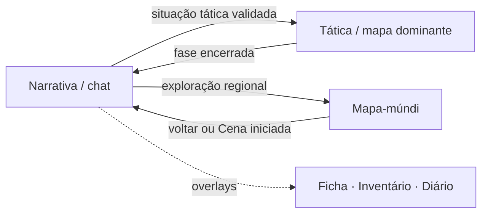

# Wireframes estruturais

Diagramas sem proporções normativas. `PROPOSTO` indica composição para prova de conceito; conteúdo e regras continuam nas fontes do produto.

## Interface principal / narrativa

```text
┌ Jornada · local · Fora de Cena/Cena ────────────────────────────────┐
│ [Mapa-múndi] [Ficha] [Inventário] [Diário] [Continuidades]          │
├──────────────────────────────────────────────┬───────────────────────┤
│ CHAT PRINCIPAL                               │ CONTEXTO (recolhível) │
│ Narrador / jogador / sistema / motor         │ protagonista           │
│ histórico selecionável e rolável             │ Ambição · Desejo       │
│ [proposta de teste inline, quando houver]    │ local · participantes  │
│                                              │ recursos oficiais      │
├──────────────────────────────────────────────┴───────────────────────┤
│ [entrada em linguagem natural........................] [Enviar]      │
│ status IA · salvar/stream/cancelar sem perder rascunho               │
└──────────────────────────────────────────────────────────────────────┘
```

**CONFIRMADO:** chat principal, contexto da Cena, acessos à ficha/inventário/diário; Cena narrativa sem mapa localizado. **PROPOSTO:** lateral recolhível e prompt de teste inline. Em largura reduzida, contexto vira drawer, mas compositor e histórico permanecem.

## Interface tática

```text
┌ Cena · situação tática ──────────────────────────────────────────────┐
│ [Sair/encerrar fase*] contexto · participantes · estado do motor     │
├───────────────────────────────────────────────┬──────────────────────┤
│ MAPA LOCALIZADO PIXI (PREDOMINANTE)           │ participantes         │
│ grid · terreno · tokens-moeda                 │ estado/ações*         │
│ seleção e alcance somente se validados        ├──────────────────────┤
│                                               │ CHAT SECUNDÁRIO       │
│                                               │ narração/resultados   │
├───────────────────────────────────────────────┴──────────────────────┤
│ detalhe do alvo/ação contextual* · feedback mecânico                 │
└──────────────────────────────────────────────────────────────────────┘
* comportamento mecânico PENDENTE
```

O chat pode expandir sem destruir o estado/viewport do mapa. Entrar/sair preserva histórico e Cena. Não há barras de MMORPG, hotbars extensas ou minimapa redundante.

## Mapa-múndi

```text
┌ Mundo · região ──────────────────────────────────────────────────────┐
│ [Voltar à Jornada] localização atual · filtros conhecidos*           │
├──────────────────────────────────────────────────┬───────────────────┤
│ MAPA HEXAGONAL REGIONAL                          │ local/POI          │
│ hexes conhecidos/desconhecidos                   │ descrição factual │
│ ● localização · ◇ pontos conhecidos              │ [Explorar/Viajar]*│
│ pan/zoom acessível + alternativa por lista        │ riscos conhecidos │
├──────────────────────────────────────────────────┴───────────────────┤
│ chat Fora de Cena acessível, sem virar chat de Cena automaticamente  │
└──────────────────────────────────────────────────────────────────────┘
* detalhes PENDENTES
```

Mapa-múndi é separado do mapa tático. Selecionar hex não confirma deslocamento; o motor valida qualquer ação persistente.

## Bibliotecas e criação

```text
┌ Mundos / Jornadas ───────────────────────────────────────────────────┐
│ busca · filtros · [Criar]                                            │
├───────────────────────────────┬──────────────────────────────────────┤
│ lista de cards                │ detalhes, versão e ações             │
│ vazio → explicação + CTA      │ conflitos/compatibilidade explícitos│
└───────────────────────────────┴──────────────────────────────────────┘

┌ Assistente de criação ───────────────────────────────────────────────┐
│ etapas/tabs: identidade → configuração → revisão                     │
│ formulário DOM acessível                                             │
│ [Voltar] [Salvar rascunho]                              [Confirmar]  │
└──────────────────────────────────────────────────────────────────────┘
```

## Ficha, inventário e diário

```text
┌ Janela auxiliar ─────────────────────────────────────────────────────┐
│ tabs semânticas · título · fechar                                    │
├──────────────────────────────────────────────────────────────────────┤
│ Ficha: resumo + seções oficiais                                      │
│ Inventário: slots/lista + detalhe; ações passam pelo motor            │
│ Diário: índice + página/editor DOM; livro é moldura, não canvas texto │
└──────────────────────────────────────────────────────────────────────┘
```

## Continuidades e salvamentos

```text
┌ Árvore de continuidades ─────────────────────────────────────────────┐
│ [zoom/filtro PROPOSTOS]                                              │
│ original ── marco ── atual                                           │
│                 └── ramo A ── atual                                  │
│                      └── ramo B                                      │
├───────────────────────────────────┬──────────────────────────────────┤
│ navegação visual + lista acessível│ origem · progresso · ações       │
└───────────────────────────────────┴──────────────────────────────────┘
```

Consulta não ramifica. Retomar salvamento anterior cria ramo automático; excluir/arquivar exige confirmação e segue ADR-043. A lista alternativa é obrigatória para teclado/leitor de tela.

## Transições principais



