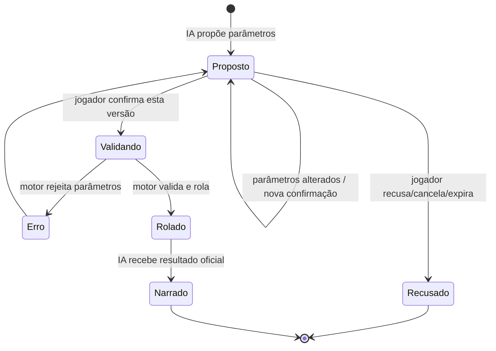

# Fluxos e interações

## Contrato de autoridade

**CONFIRMADO:** a IA interpreta e propõe; o motor valida regras, rolagens, inventário, recursos, posição e estado persistente. Texto narrativo nunca confirma sozinho uma mutação. Toda operação recebe identificador para retry não duplicar efeito (**PROPOSTO** como contrato técnico).

## 1. Criar personagem e iniciar Jornada

`Biblioteca → Criar → escolher Mundo/versão → preencher apenas campos aprovados → revisar Ambição/Desejo → motor valida → confirmar → persistir Jornada → abrir Fora de Cena`.

- Cancelar mantém rascunho apenas se o jogador escolher; erro aponta campo/regra sem criar Jornada parcial.
- Competências/Capacidades não aparecem na primeira fase. Mundo incompatível bloqueia confirmação com explicação.

## 2. Conversar com NPC

`Fora de Cena: intenção → sistema contextualiza → abre Cena com chat próprio → IA interpreta NPC → jogador fala/age → ferramentas propostas → motor aceita/recusa → IA narra retorno → desfecho → consolida estado → Fora de Cena`.

Pergunta direta ao Narrador não vira fala do protagonista. Retry de IA reutiliza contexto, mas não reaplica compra/efeito. Sair com operação pendente exige esperar, cancelar de modo seguro ou manter pendência explícita.

## 3. Solicitar e confirmar teste (fora da tática)

Antes da confirmação não há dado, gasto ou consequência mecânica. Recusa não implica sucesso/falha. Política dentro da tática permanece **PENDENTE**.

## 4. Receber resultado de rolagem

Motor retorna resultado estruturado → UI fixa cartão imutável com parâmetros/resultado → Narrador narra sem mudar números → persistência associa proposta, confirmação e consequência. Erro de narração preserva o resultado e oferece retry apenas da narrativa. **PROPOSTO:** diferenciar visualmente “resultado mecânico” de prosa.

## 5. Abrir e gerenciar inventário

Abrir overlay preserva contexto → buscar/listar estado oficial → selecionar slot/item → exibir ações válidas informadas pelo motor → confirmar ação quando necessário → motor aplica atomicamente → UI atualiza. Vazio oferece explicação; leitura falha mantém última visão marcada como desatualizada, sem permitir mutação perigosa.

## 6. Equipar e utilizar itens

Selecionar item → solicitar ações válidas → escolher equipar/usar → mostrar alvo/custo conhecidos → confirmar → motor revalida disponibilidade/estado → aplicar ou recusar → registrar evento → Narrador pode contextualizar. DnD é atalho, nunca única forma. Rejeição não remove item. Regras de slots/consumo não são inferidas dos sprites.

## 7. Entrar e sair de combate/situação tática

Gatilho narrativo/estado → motor valida fase tática → UI preserva Cena e monta mapa/tokens → mapa assume prioridade, chat continua → ações propostas/validadas → desfecho do motor → consolidar estado → desmontar mapa sem apagar histórico → retornar à narrativa. Se mapa falha, bloquear ações espaciais e permitir diagnóstico/cancelamento seguro; não resolver por texto da IA.

## 8. Alternar entre chat e mapa

- Narrativa ↔ tática: transição de modo da mesma Cena, preservando scroll, rascunho, seleção e viewport quando possível.
- Jornada ↔ mapa-múndi: modo de exploração separado; chat Fora de Cena permanece acessível.
- **PROPOSTO:** atalhos com foco previsível; Escape fecha painel, não abandona modo sem confirmação.

## 9. Explorar mapa-múndi

Abrir região → motor fornece hexes/POIs conhecidos e localização → selecionar hex apenas consulta → escolher explorar/viajar → confirmar dados disponíveis → motor valida deslocamento/consequência → atualizar localização → eventual Cena. Erro de geração/rota não move personagem. Frequência de eventos, custo e escala são **PENDENTES**.

## 10. Consultar diário/editor

Abrir diário → listar entradas/resumos persistidos → ler → solicitar texto literário sob demanda → modelo gera rascunho → jogador revisa/edita/aprova → salvar versão editorial → exportar. Cancelar geração não altera diário factual; falha mantém rascunho. Voz, perspectiva e modelo editorial seguem configurações aprovadas, sem reescrever fatos canônicos.

## 11. Restaurar salvamento e criar ramificação

Escolher marco anterior → mostrar origem e impacto → confirmar retomada → verificar integridade → criar automaticamente nova continuidade independente → carregar ramo. A original permanece. Consulta e preview não ramificam; falha transacional não cria ramo parcial.

## 12. Navegar pela árvore de continuidades

Abrir árvore/lista → selecionar nó → consultar origem/progresso → retomar, arquivar ou excluir conforme permissão. Retomar ponto anterior segue fluxo 11. Operações nunca transferem inventário, memória ou derrotas entre ramos. Layout, zoom e filtros são **PROPOSTOS**; independência é **CONFIRMADA**.

## 13. Exportar e importar backups

- Exportar: escolher escopo → calcular dependências de Mundo → excluir segredos, modelos e assets comerciais → validar integridade → seletor nativo → escrever pacote local → confirmar hash/local.
- Importar: selecionar → ler sem aplicar → verificar integridade/versão → preview → detectar conflitos → jogador aprova resolução → migração controlada → transação atômica → relatório.
- Cancelamento não altera base. Formato e UX detalhada permanecem **PENDENTES**; backup não é exportação literária.

## 14. Configurar modelos de IA

Escolher local/online → exibir privacidade/capacidades → local: download/importação, integridade e compatibilidade; online: inserir segredo em armazenamento seguro → testar conexão/inferência sem estado canônico → confirmar associação → usar protocolo comum. Erro/timeout não troca modelo silenciosamente. Troca preserva Jornada/memória; API key não aparece em log/backup.

## Estados globais de interação

| Estado | Regra |
|---|---|
| loading | operação ainda não produziu efeito; cancelar somente quando seguro |
| empty | explica ausência e ação válida; não gera conteúdo falso |
| offline/IA indisponível | leitura e gestão local continuam quando possível; sem inventar resposta |
| stale | mostra dado anterior marcado e bloqueia mutação que exige atualidade |
| retry | reexecuta etapa idempotente; transação mecânica usa resultado anterior/consulta |
| conflict | jogador escolhe entre opções explicadas; não há merge silencioso |

